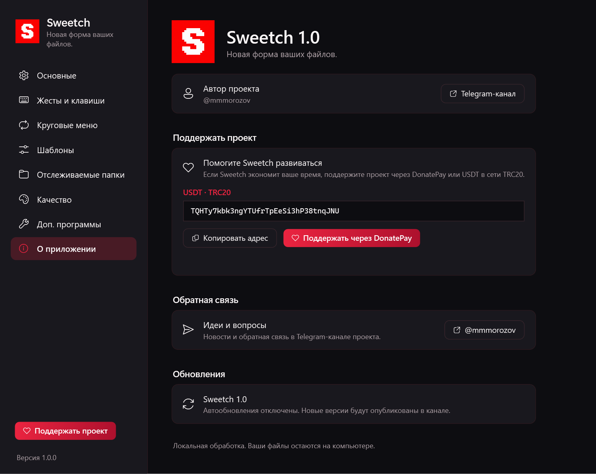
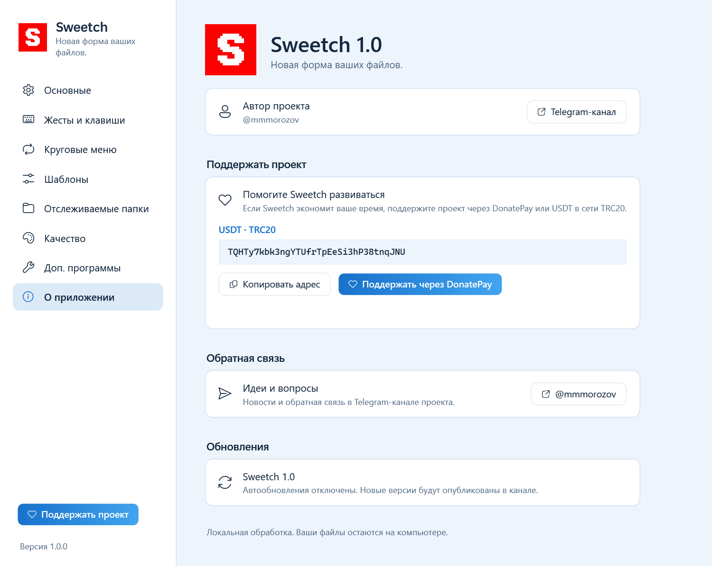

# Sweetch 1.0

Файловый конвертер для Windows с круговым меню. Автор проекта Sweetch: [@mmmorozov](https://t.me/mmmorozov).

<p align="center">
  
  
</p>

Перетащите файл и нажмите **Shift** для конвертации, **Ctrl** для инструментов или **Alt** для действий. Отпустите файл над нужным сектором. Для работы без мыши выберите файлы в Проводнике и нажмите **Ctrl + Alt + Space**.

## Запуск

Распакуйте весь архив и запустите `Sweetch.exe`. Программа находится в области уведомлений рядом с часами; двойной щелчок открывает настройки. Требуется Windows 10 (1809+) или Windows 11, x64. .NET включён в переносную сборку.

Язык: **Как в системе / Русский / English**. Для остальных языков системы используется английский. Оформление: **Как в системе / Тёмная / Светлая**. Тёмная тема — красно-чёрная, светлая — бело-голубая.

Настройки хранятся в `%APPDATA%\Sweetch`, загружаемые инструменты — в `%LOCALAPPDATA%\Sweetch\tools`. Скриншоты и виртуальные вложения сохраняются в `Downloads\Sweetch`. Исходные файлы не перезаписываются.

## Форматы

Изображения (включая RAW с камер: CR2/CR3, NEF, ARW, RAF, DNG, ORF, RW2 и др.), аудио, видео, PDF, документы, таблицы, презентации, субтитры и архивы. Доступные операции зависят от типа входного файла. **Pandoc 3.12.1 включён в архив**: конвертация DOCX, Markdown, HTML, EPUB, RTF и TXT не требует скачивания Pandoc. Распакуйте всю папку, включая `tools`. Для аудио и видео FFmpeg скачивается через настройки; LibreOffice для части операций Office/PDF устанавливается отдельно. Обработка файлов локальная.

## Поддержать проект

- [DonatePay](https://donatepay.ru/don/1539048)
- USDT · TRC20: `TQHTy7kbk3ngYTUfrTpEeSi3hP38tnqJNU`
- [Telegram-канал](https://t.me/mmmorozov)

Автообновления отключены: Sweetch 1.0 не обращается к серверу обновлений и не устанавливает сторонние версии. Новые версии будут объявляться в канале. Обратная связь открывает Telegram; встроенной отправки сообщений на сторонний сервер нет.

## Сборка

Нужен .NET SDK 10. Сборка включает официальный Windows-пакет Pandoc с проверкой SHA-256; для этого нужен доступ к GitHub Releases. У конечного пользователя запросов к GitHub API для Pandoc нет. В PowerShell из папки проекта:

```powershell
./build.ps1
dotnet test tests/Sweetch.Tests -c Release
./publish/Sweetch.exe --self-test ./self-test
```

В `.github/workflows/build.yml` подготовлена сборка Windows и переносного ZIP для будущего репозитория. Репозиторий проекта: [krllmrzv/Sweetch](https://github.com/krllmrzv/Sweetch).

## Лицензия

См. `LICENSE` и `THIRD-PARTY-NOTICES.md`. В них сохранены обязательные уведомления об авторских правах на используемый код и зависимости. Название Sweetch, изменения оформления и локализации — проект @mmmorozov.
